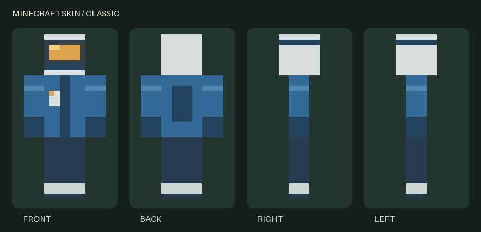

# Minecraft Skin Toolkit

Local tools for Codex, Claude Code, and other agents to create standard Minecraft skins, inspect them, and revise them. Original implementation; no PMCSkin3D code or assets.



The agent designs the character. The toolkit maps face-local rectangles into a 64×64 RGBA PNG, checks the result, and returns front/back/side previews. It provides a CLI and the same functions through a local stdio MCP server. No hosted service, accounts, API keys, telemetry, or network calls at runtime.

## Install

Requires Python 3.11+ and [uv](https://docs.astral.sh/uv/).

```sh
git clone https://github.com/Griff2325/minecraft-skin-toolkit.git
cd minecraft-skin-toolkit
uv sync --locked
uv run minecraft-skin build examples/cobalt-explorer.json --name explorer --output-root ./skin-output
uv run minecraft-skin validate skin-output/explorer/skin.png --model classic
uv run minecraft-skin preview skin-output/explorer/skin.png --output ./explorer-preview.png
```

Each build creates a new folder with `skin.png`, editable `design.json`, and `preview.png`. Existing folders and files are never overwritten. Use a new name for each revision.

## Connect an agent

Replace `/absolute/path/minecraft-skin-toolkit` with your checkout and `/absolute/path/skin-output` with a dedicated output directory. Use absolute paths so the server works regardless of the client's working directory.

**Codex**

```sh
codex mcp add minecraft-skins -- uv run --directory /absolute/path/minecraft-skin-toolkit --locked minecraft-skin-mcp --output-root /absolute/path/skin-output
```

**Claude Code**

```sh
claude mcp add --transport stdio --scope user minecraft-skins -- uv run --directory /absolute/path/minecraft-skin-toolkit --locked minecraft-skin-mcp --output-root /absolute/path/skin-output
```

Restart the client/session to discover the server. The commands above configure local processes; they do not expose a network server. The MCP tools can only read/write within the configured output directory. Do not point it at a directory containing secrets.

| Tool | Result |
| --- | --- |
| `skin_schema` | Complete input JSON schema and all classic/slim face dimensions |
| `skin_build` | New PNG, design, validation report, and inline preview image |
| `skin_validate` | Size, base opacity, per-part coverage, and actionable errors |
| `skin_preview` | Inline front/back/right/left inspection sheet |

The MCP server uses the official Python MCP SDK. Full input schemas are discoverable by the client. Direct CLI/Python calls also validate their input.

Optional workflow skill: copy `skills/minecraft-skins/` into `~/.codex/skills/` or `~/.claude/skills/`. It contains the same portable `SKILL.md`; neither client requires a skill to call the MCP tools.

Example request:

> Make an original classic skin: strawberry-blonde hair, moustache, white henley, blue jeans, and brown cowboy boots. Build it, inspect the returned preview, then refine it under a new revision name. Save the PNG and editable design.

## Design format

See [the complete example](examples/cobalt-explorer.json), or run `uv run minecraft-skin schema --model slim`.

```json
{
  "model": "classic",
  "palette": {"skin": "#E9B38E", "shirt": "#EEECE4", "jeans": "#3C6685"},
  "base": {"head": "skin", "body": "shirt", "right_arm": "shirt", "left_arm": "shirt", "right_leg": "jeans", "left_leg": "jeans"},
  "paint": [{"part": "body", "layer": "base", "face": "front", "rect": [3, 2, 1, 1], "color": "jeans"}]
}
```

`rect` is `[x, y, width, height]` in face-local texels. Coordinates start at the face's upper left as viewed from outside. Left/right refer to the character. For top faces, the upper edge is the back; for bottom faces, the upper edge is the front. Paint operations replace pixels in order, including alpha. Use palette names for colors; palette values accept `#RRGGBB` or `#RRGGBBAA`.

All six base fills are required and must be opaque. Overlays start transparent. Classic arms are 4 texels wide; slim arms are 3. The selected arm model is separate game metadata: a PNG cannot reliably prove which model its creator intended. Limits: 256 palette entries and 4096 paint rectangles. Legacy 64×32 and HD 128×128 skins are outside this release.

The preview composites outer layers at native texel scale; it is an orthographic inspection sheet, not a 3D game render. Visual likeness and clothing quality require agent/user judgment. Validation verifies technical texture properties, not Minecraft server acceptance.

## Use in Minecraft and Blockintosh

Import `skin.png` as a custom classic skin in Minecraft's Dressing Room and choose the matching classic/slim model. PMCSkin3D is an optional manual refinement editor: open the exported PNG and inspect the model there.

Blockintosh's [official add-on documentation](https://blockintosh.multision.dev/docs.html#addons) lists `.mcskin` and `.mcpack` imports. This first release exports PNGs only; it does not claim launcher package integration, edit the launcher, or access Microsoft/Xbox accounts. Test the skin in your own game before relying on it for Realms. Console and platform-specific custom skin restrictions still apply.

## Development and verification

```sh
uv run python -m unittest discover -s tests -v
uv build
```

Tests cover independent classic/slim UV coordinates, cube orientation, atlas overlap, malformed inputs, PNG roundtrips, transparency, CLI build/validate/preview, MCP initialize/discovery/all four tool calls, file confinement and no-overwrite behavior.

Runtime dependencies: Pillow and `mcp` (which includes Pydantic). `uv.lock` records the tested environment. No site code or bundled Minecraft textures are redistributed. Generic example assets are original and included under the MIT license.

## Project status

Initial release. Technical tests pass. External editor and in-game acceptance need manual verification and are recorded separately from automated checks. Contributions should stay focused on agent authoring, useful validation, previews, and tested import/export.

MCP client references: [Codex](https://learn.chatgpt.com/docs/extend/mcp), [Claude Code](https://code.claude.com/docs/en/mcp). PMCSkin3D's [help](https://www.planetminecraft.com/pmcskin3d/~/) and [terms](https://www.planetminecraft.com/terms_of_use) are independent of this project.

MIT licensed. Independent community project; not affiliated with Mojang, Microsoft, Planet Minecraft, or Blockintosh.
